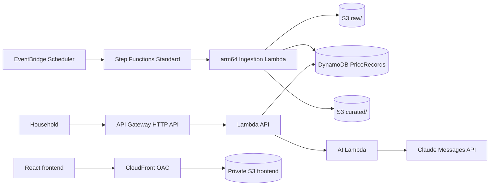

# TamBooh

TamBooh is a Peru-focused AWS serverless MVP for affordable meal planning, wholesale agricultural price monitoring, and climate-resilience simulations.

The application keeps source prices in PEN, preserves provenance, uses deterministic Python calculations for budgets and quantities, and uses Claude only to explain validated application facts. Demonstration data is clearly labeled and must not be treated as live market data.

## What is included

- React + TypeScript + Vite + Tailwind frontend.
- Python 3.12 Lambda API with deterministic published-price, shopping-list and price-scenario calculations.
- Claude Messages API integration with Secrets Manager and deterministic fallback.
- MIDAGRI wholesale ingestion module under `src/`.
- Step Functions Standard workflow with a Map state for four source families.
- S3 raw dataset preservation and curated CSV output.
- DynamoDB normalized price records with date-query GSI.
- EventBridge Scheduler at 07:00 `America/Lima`.
- CloudFront with S3 Origin Access Control for frontend delivery.
- AWS SAM infrastructure and manual GitHub Actions deployment: dev IAM access-key secrets, production OIDC scaffolding.

## Architecture



## Repository layout

```text
backend/                  Existing API and business services
frontend/                 React/Vite application
src/common/               Ingestion models, parsers, units, storage
src/functions/            Ingestion and reporting Lambda handlers
statemachine/              Step Functions ASL definition
events/                   Local and manual execution inputs
data/samples/              Clearly labeled demonstration data
tests/                    Unit tests and parser fixtures
infrastructure/           IAM policy documents and supporting config
docs/                     Architecture, security, operations, and runbooks
scripts/                  Deployment, backfill, smoke-test, and local runners
template.yaml             AWS SAM infrastructure
```

## Local setup

Requirements: Python 3.12, Node.js 22, AWS SAM CLI for infrastructure commands, and an AWS account only for deployment.

```bash
cd aws-tambooh
python3.12 -m venv .venv
source .venv/bin/activate
pip install -e '.[dev]'
pytest -q
```

Run the frontend:

```bash
cd frontend
npm ci
npm test
npm run dev
```

Copy `frontend/.env.example` to `frontend/.env` to select the public API base URL for local development. The deployment workflow obtains it from CloudFormation automatically. See [Frontend](docs/frontend.md) for its data states, tests, required upload permissions and publication flow.

The API handler can be invoked locally through SAM or directly from Python:

```bash
sam local invoke ApiFunction -e events/api-health.json
```

The INS recipe/nutrition import contract can be checked before any catalog is published:

```bash
python scripts/validate_recipe_catalog.py reviewed-ins-catalog.json
python scripts/validate_recipe_catalog.py reviewed-ins-catalog.json --output /tmp/validated-ins-catalog.json
```

No recipe/nutrition catalog is bundled. Validation checks schema and attribution, not the truth of imported nutrition values; review the official source and its reuse terms before loading data. See [Data sources](docs/data-sources.md).

Claude is disabled by default. For local use only, export `ANTHROPIC_API_KEY` and `ENABLE_AI=true` into the process environment; `.env` is a private storage convenience and is not loaded automatically by Python. Never put the key in React or a `VITE_*` variable.

## Test the ingestion flow without AWS

The local runner executes the same fetch/parse worker without deploying Lambda or writing to AWS:

```bash
for source in sisap_mananero gmml_ingreso papa_boletin productores; do
  PYTHONPATH=. python scripts/local_ingest.py --source "$source"
done
```

Process a downloaded SISAP PDF:

```bash
curl -L --max-time 60 \
  -A 'TamBooh-ingest/0.1 (+contacto)' \
  -H 'Accept: application/pdf,*/*' \
  -o /tmp/reporte_precios.pdf \
  'http://sistemas.midagri.gob.pe/sisap/intranet/mayoristas_lima/modulos/reporte_precios.pdf'

file /tmp/reporte_precios.pdf
PYTHONPATH=. python scripts/local_ingest.py \
  --source sisap_mananero \
  --file /tmp/reporte_precios.pdf
```

The worker validates `%PDF`, computes SHA-256, extracts the Spanish observation date, parses with `pdfplumber`, detects missing values, and calculates reliable price-per-kg values. HTTP-only SISAP is recorded as `http_insecure`; the code never disables TLS verification for HTTPS.

## MIDAGRI ingestion

The Step Functions workflow is defined in [statemachine/ingest.asl.json](statemachine/ingest.asl.json). It runs the source Map, fetches each source, stores raw files, reads the object from S3, parses and validates records, writes DynamoDB, publishes curated CSV, and reports source-level success or failure.

Sources currently represented:

| Source | Role | Status |
|---|---|---|
| SISAP Mañanero | Daily wholesale price PDF | HTTP source; no historical endpoint |
| GMML/SIEA | Wholesale entry and price report | Dated path resolver, including set/sep candidates; live layout unverified |
| Papa bulletin | Daily potato bulletin | Bounded collection/month discovery; live layout unverified |
| Productores Santa Anita | Grocery wholesale report | Bounded collection/month discovery; live layout unverified |

Run a manual execution after deployment:

```bash
aws stepfunctions start-execution \
  --state-machine-arn <STATE_MACHINE_ARN> \
  --input file://events/ingestion.json
```

See [docs/price-ingestion.md](docs/price-ingestion.md) for source limitations, S3 paths, DynamoDB keys, and troubleshooting.

## AWS deployment

The configured target is account `786638967830`, region `us-east-2` (Ohio). Create the private artifact bucket `tambooh-dev-artifacts-786638967830` and the deployment roles before running the workflow. Exact prerequisites and GitHub environment variables are in [Deployment](docs/deployment.md).

The AWS Projects account blocked OIDC provider creation. For the requested dev alternative, follow [Access-key deployment](docs/access-keys-deployment.md): upload the standalone CloudFormation template, create the dedicated user's key manually, and store it only in GitHub environment secrets. The workflow verifies the target account before deployment. Static credentials remain subject to SCP restrictions. The operator has confirmed the dev stack and a successful manual PDF ingestion; new frontend publication still requires deployment. Production retains the separate [OIDC bootstrap](docs/bootstrap-access.md).

For optional Claude, create the Anthropic secret outside SAM in us-east-2. Ingestion can deploy with AI disabled and no secret. Do not pass the API key as a CloudFormation parameter:

```bash
aws secretsmanager create-secret \
  --name tambooh/dev/anthropic-api-key \
  --region us-east-2 \
  --secret-string '{"ANTHROPIC_API_KEY":"YOUR_KEY"}'
```

Validate and build:

```bash
sam validate --lint --template-file template.yaml
sam build
```

Deploy interactively the first time:

```bash
sam deploy --guided
```

Or use the helper script after `samconfig.toml` is configured:

```bash
AWS_PROFILE=YOUR_TAMBOOH_PROFILE bash scripts/deploy.sh dev
```

Development deployment reads its dedicated IAM access keys from GitHub environment secrets. Production retains OIDC federation and requires approval configured through a protected GitHub environment. Neither workflow stores credentials in source files.

Deployments run on demand. After the workflows exist on the default branch `master`, open **Actions → Deploy dev → Run workflow**, select branch **dev**, and start the run. Pushes and pull requests run validation through CI but do not deploy. The GitHub environment `dev` must permit deployments from the branch `dev`.

## Current validation status

The repository has been locally validated with:

```text
pytest -q             Regression suite covers persistence, units, workflow and publication
Step Functions JSON   valid
SAM template          valid with sam validate --lint
```

The operator confirmed a dev deployment in us-east-2, successful Step Functions execution ef7910e6-dd7f-4e4b-bd8d-f9815f293e74, and an API response with 18 wholesale records from the manually uploaded 2026-11-16 Mañanero PDF. The operator also reports that the frontend is published at CloudFront. Automatic source downloads remain incomplete: SISAP/SIEA connections timed out and the gob.pe search did not locate the requested report. That evidence does not prove geographic IP filtering. A real Mañanero PDF fixture tests its two-row header; the other source layouts remain unverified. The shopping planner changes in this workspace have not yet been deployed. Production readiness is not claimed. See [Frontend](docs/frontend.md).

The ingestion API reads active manifests and complete versioned S3 snapshots. Failed staging writes leave the last active publication visible. Source processing is serialized in the Map to respect shared-domain pacing. Meal planning currently validates requests but returns `DATA_UNAVAILABLE`: verified INS nutrition, a source-attributed recipe catalog, compatible prices and a dated FX reference are prerequisites. It does not return a hard-coded recipe or infer a USD budget comparison. Historical trend output is marked insufficient_history until a compatible history calculation service is implemented.

## Documentation

- [Architecture](docs/architecture.md)
- [Deployment](docs/deployment.md)
- [Frontend and publication](docs/frontend.md)
- [Security](docs/security.md)
- [Claude integration](docs/claude-integration.md)
- [MIDAGRI ingestion](docs/price-ingestion.md)
- [Step Functions operations](docs/step-functions.md)
- [Data sources](docs/data-sources.md)
- [Limitations](docs/limitations.md)

