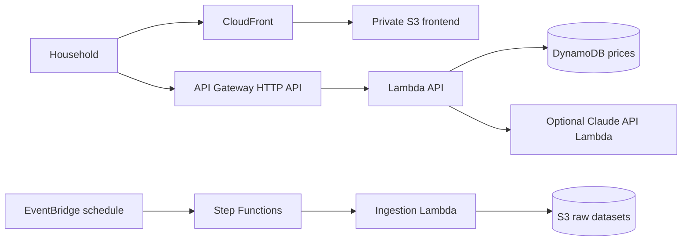
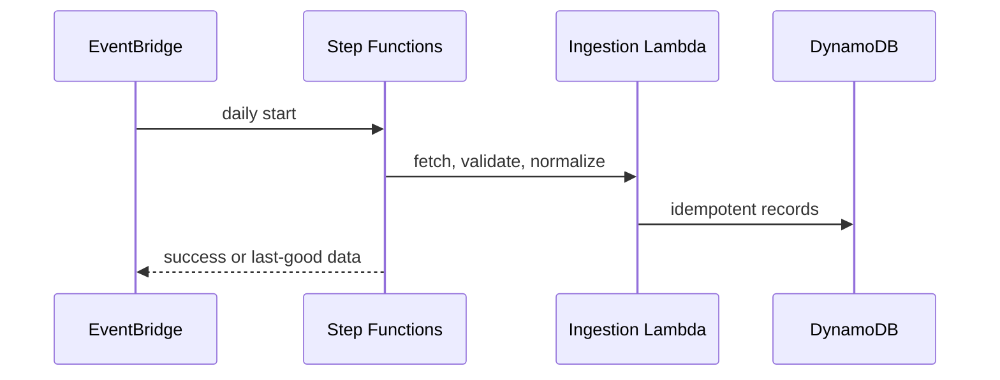
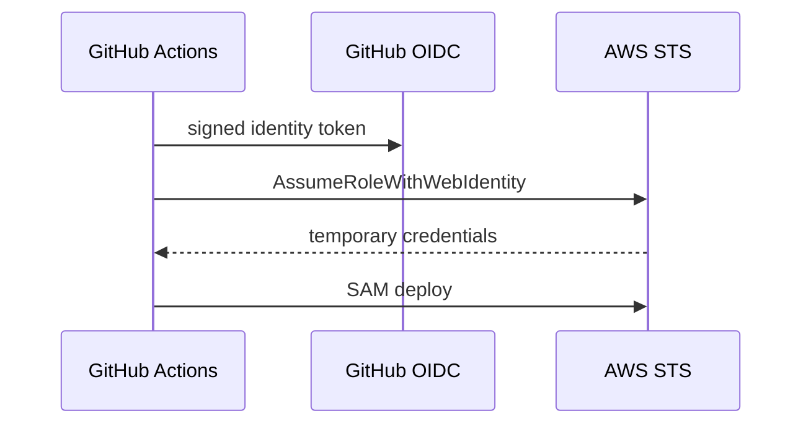
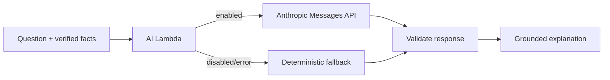

# Architecture

React/Vite is hosted from S3 behind CloudFront. API Gateway HTTP API routes to Python 3.12 Lambda. Deterministic calculation services own costs, quantities, inventory deduction, and simulations. DynamoDB stores normalized price records; S3 stores raw imports. EventBridge starts a Step Functions ingestion workflow. Claude is optional and receives verified facts only.

