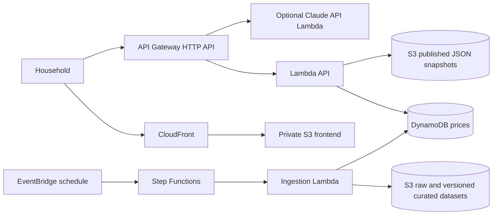
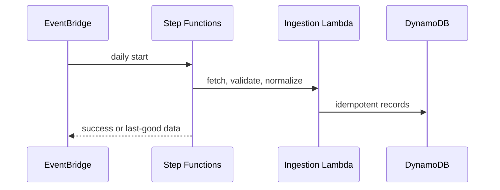
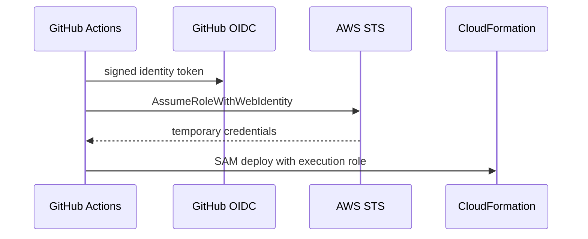
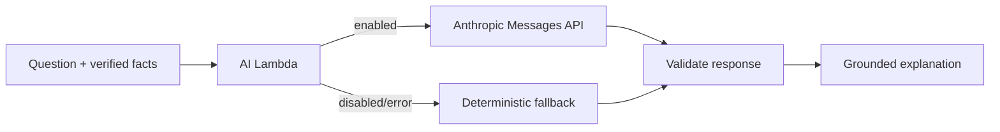

# Architecture

React/Vite is hosted from S3 behind CloudFront. API Gateway HTTP API routes to Python 3.12 Lambda. Deterministic calculation services own costs, quantities, inventory deduction, and simulations. DynamoDB stores normalized price records; S3 stores raw imports. EventBridge starts a Step Functions ingestion workflow. Claude is optional and receives verified facts only.

Dev deployment uses a dedicated IAM user's key pair in GitHub environment secrets and a separate CloudFormation execution role. See [dev deployment diagram](diagrams/dev-deployment.mmd). The OIDC sequence below represents the retained production path; AWS Projects currently blocks creation of its provider in the target account.

